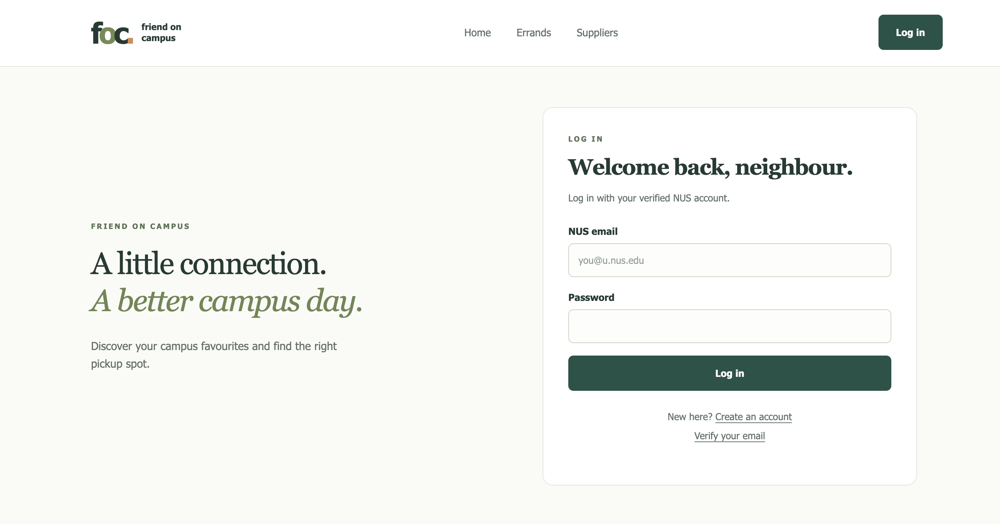
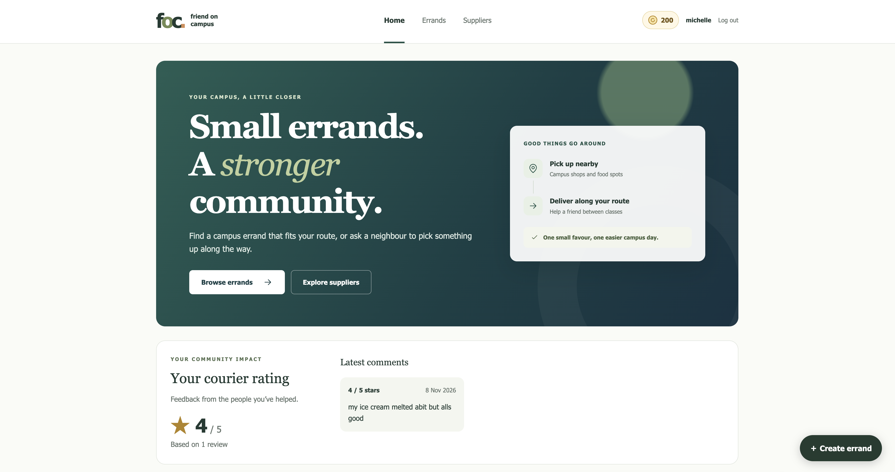
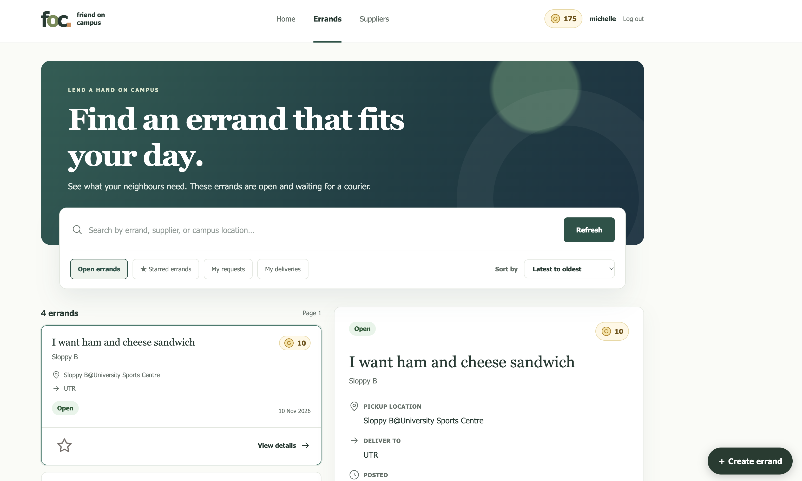
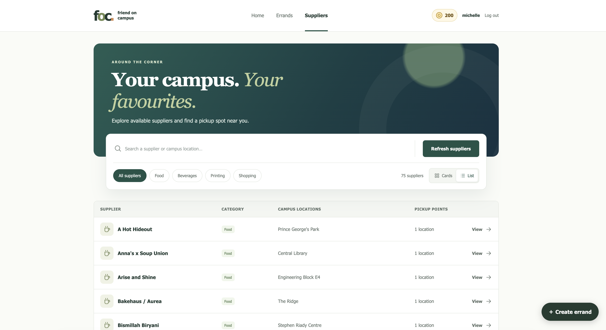
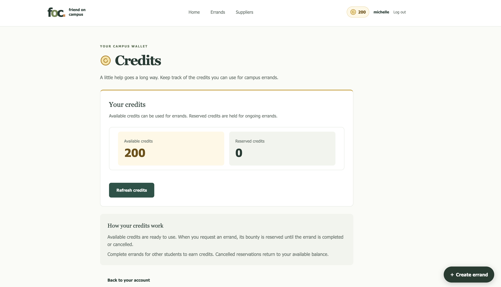

<!-- AI-assisted disclosure draft: OpenAI Codex, GPT-6.1; author review required before submission. -->
# CS3219 - Friend on Campus (FoC)

Friend on Campus is a peer-to-peer campus errand platform. A student can
request an item from a campus supplier, another student can fulfil the errand,
and credits circulate within the platform as a closed, non-monetary economy.

## Currently supported operations

With the required backend services running, the app supports:

- **Accounts:** Register with an NUS email address, verify email, resend a
  verification code, log in, and log out.
- **Profile settings:** View account details, update a phone number, and change a
  password using the current password.
- **Supplier browsing:** Search suppliers, switch between list and card views,
  and filter by Food, Beverages, Printing, or Shopping. Suppliers with multiple
  tags appear under each applicable filter.
- **Pickup details:** View supplier outlets, buildings, available floor details,
  pickup descriptions, and opening hours.
- **Errand creation:** Select a supplier pickup location, enter the request and
  delivery details, choose the item type, and offer credits.
- **Errand discovery:** Browse available errands, view their details, and sort by
  creation time or offered credits.
- **Bookmarks:** Star and unstar errands and browse starred errands.
- **Request management:** View personal requests, edit eligible open and
  unassigned requests, and cancel requests before pickup.
- **Courier deliveries:** Accept an available errand, view assigned deliveries,
  mark items as picked up or delivered, and release an accepted errand before
  pickup.
- **Delivery confirmation:** Confirm receipt to complete an errand, or dispute a
  delivered errand. View its current status and lifecycle timestamps.
- **Credits:** View available and reserved balances. The backend reserves credits
  for requests, releases reservations on cancellation or expiry, and processes
  transfers after completion.
- **Courier reviews:** Submit a 1–5 star rating with an optional comment for a
  completed delivery and view courier rating summaries and feedback.
- **User reports:** Report another user for administrator review.
- **Supplier administration:** Create suppliers and outlets, edit supplier names
  and category tags, update pickup details and hours, and delete suppliers.
- **Account moderation:** Administrators can search accounts, grant or remove
  administrator privileges, review and resolve user reports, and set temporary
  account suspensions.
- **Errand administration:** Administrators can view all requests, delete
  requests, and inspect disputed deliveries. Dispute resolution is not yet
  supported.
- **Automatic lifecycle handling:** Expire eligible open requests, reopen errands
  when a courier misses the pickup deadline, and complete undisputed deliveries
  after the confirmation timeout.

## Screenshots

### Login page

Log in with a verified NUS account, or access account registration and email
verification.



### Home page

Access errands and suppliers, view your credit balance, and see your courier
rating and recent feedback.



### Errand catalog

Search and sort open errands, preview request details and offered credits,
bookmark errands, and access your requests and deliveries.



### Supplier catalog

Search suppliers and campus locations, filter by category, switch between card
and list views, and view pickup locations.



### Credits page

View and refresh available and reserved credit balances, and learn how credits
are reserved, earned, and returned during errands.



## AI Use Summary

This is a project-level disclosure for **all FoC team members** listed in the
[team members section](#team-members). It covers AI-assisted contributions across
the shared repository, rather than serving as one member's personal declaration.

**Recorded tool and model:** OpenAI Codex with GPT-6.1, confirmed on
10 November 2026. Each team member is responsible for recording any additional
tools or models they used in the shared log. 

**Team authorship:**
AI was not used for requirements elicitation, requirements prioritization,
backlog consolidation, or sprint planning; proposing or changing architecture,
component boundaries, design patterns, data schemas, or interfaces; making
performance or security trade-offs; or drafting trade-off analyses, risk mentions,
or justifications. These activities and decisions were human-authored. The
established architecture and technology choices are documented in
[architecture.md](docs/architecture.md) and [tech-stack.md](docs/tech-stack.md).
AI assisted portions of implementation, debugging, refactoring, testing, and
documentation within that project context. This does not mean the entire
codebase was AI-generated, or that every line was written without assistance.
The team remains responsible for all submitted work.

**Scope of assistance:** Our team uses this disclosure to distinguish human
authorship from AI assistance in selected implementation tasks. The recorded
examples below illustrate assisted work; they are not an exhaustive account of
every member's contributions.

- **Implementation:** Generating or adapting selected code portions within the
  established stack. Recorded examples include courier-review validation and
  endpoints, supplier category tags, migrations, API filters, CSV import updates,
  frontend filters, and administrator controls.
- **Debugging and refactoring:** Suggestions for validation, duplicate handling,
  formatting, and build/test failures.
- **Testing:** Generating and refining unit, database integration, and browser
  test cases, with the authors evaluating their relevance and results.
- **Documentation and development workflow:** Drafting implementation documentation,
  explaining code, suggesting commit messages, and providing Git guidance within
  the scope above.

**Review and verification:** The ed team confirms that all retainAI-assisted
code was reviewed by the responsible authors. Each member is accountable for
understanding, correcting, and verifying their retained AI-assisted contributions.
Relevant unit tests, PostgreSQL integration
tests, desktop/mobile Playwright tests, lint, TypeScript checks, and builds were
used for the recorded changes; see the [shared AI usage log](ai/usage-log.md).
Historical test results apply to their recorded versions, so the authors must
also verify the final submitted commit. Every member remains accountable for
understanding the entire codebase.

**Prompts, key outputs, and attribution:** [ai/usage-log.md](ai/usage-log.md)
is maintained as one shared record for the whole team. Each contributor must add
their exchanges, affected files, retained outputs, sources, and checks, including
assistance outside the currently documented examples.
Retrospective entries identify where exact prompt times were not preserved.
Known AI-assisted source portions are labelled with provenance comments. CSV
data and already-applied migrations use explicit file-level log entries to
preserve valid data formats and migration checksums; confirm this handling with
the teaching team. Assistance with migrations, endpoints, and type declarations
was limited to implementing human-defined schemas and interfaces.

**Academic integrity and licensing:** All team members must check retained outputs for
plagiarism, incompatible licenses, and uncredited third-party material. Credit
sources used for copied or adapted material. Where reuse rights are unclear,
replace the material with an implementation from the specification or an
independently worded description. Passing tests does not establish licensing
compliance. Sources for supplier catalog facts are credited in the usage log.

**Team norms and submission:** All members share responsibility for restricting
AI assistance to permitted work, reviewing and understanding retained outputs,
maintaining the log, and keeping this disclosure accurate. Each contributor records
their own usage; the team reviews the combined disclosure before submission.
Every member must confirm these norms,
complete the [submission audit](ai/usage-log.md#team-submission-audit), and link
this README's [AI Use Summary](#ai-use-summary) from the submission slide deck.
Keep all tracked [AGENTS.md files and repository skills](ai/usage-log.md#agent-instructions-and-skills)
in the submission and add any other instructions or skills actually used.

## Current milestone

The React frontend is available in `web-app/`, with account registration,
verification, login, supplier browsing, credit balances and open errands connected to the existing services.
There is no mock-data fallback. User, Supplier, Credit and Order Services must be running. See
[web-app/README.md](web-app/README.md) for startup and verification commands.

On Windows, start Docker Desktop, then run from this folder:

```powershell
powershell -NoProfile -ExecutionPolicy Bypass -File scripts/start-local.ps1
```

Add `-Install` on first setup. Open http://localhost:3000, log in, and click
the gold coin and balance in the top bar to open the credits page. Missing credit
accounts receive the configured starting credits exactly once after login.
Existing balances are preserved.

## Repository layout

```text
.
|-- web-app/                 Responsive student and administrator client
|-- user-service/            Accounts, profiles, authentication, privileges
|-- supplier-service/        Suppliers and campus pickup locations
|-- order-service/           Errand creation, discovery, and lifecycle
|-- credit-service/          Credit balances, reservations, and settlement
|-- data/                    Non-production seed assets
|-- docs/                    Cross-service architecture decisions
|-- compose.yaml             Local service and infrastructure orchestration
`-- .env.example             Shared environment-variable catalogue
```

Each backend service maintains its own source code, database migrations, tests,
and container build. Refer to its README for the service-specific internal layout
and development commands.

The web client uses a feature-oriented layout. See
[docs/architecture.md](docs/architecture.md) for ownership rules and allowed
dependencies, and [docs/tech-stack.md](docs/tech-stack.md) for the technology
choices all contributors and coding agents must follow.

## Team members

| Name | Ownership |
| --- | --- |
| Teng Yu Sheng Arthur | User Service |
| Michelle | Supplier Service |
| Nur Hidayah Binte Zulkifli (Hazel) | Credit Service and UI |
| Hasan Ahmed Nasif | Order Service |
| Toh Jun Yee | Order Service and UI |

Nice-to-have capabilities should remain inside an existing service when they
share its domain. Add another top-level service only when it has independent
data ownership and deployment needs.

Order Service FR4 implementation and manual PowerShell launch commands: [order-service/README.md](order-service/README.md).

## Windows pnpm lockfile troubleshooting

Use the repository-pinned pnpm version (currently 12.11.2) and Windows system certificates:

```powershell
$env:NODE_OPTIONS = "--use-system-ca"
pnpm --version
pnpm install --frozen-lockfile
```

If a merge left missing dependency snapshots or manifest/lock mismatches, repair from the repository root, then verify reproducibility:

```powershell
$env:NODE_OPTIONS = "--use-system-ca"
pnpm install --fix-lockfile
pnpm install --frozen-lockfile
```

User Service and Supplier Service have independent lockfiles; run their frozen installs from their respective directories. Keep the root pnpm-lock.yaml changes in source control. Its package-manager environment and application dependency data are separate YAML documents in the same file; both are required. Do not disable certificate or package-manager signature verification to work around verification errors.
